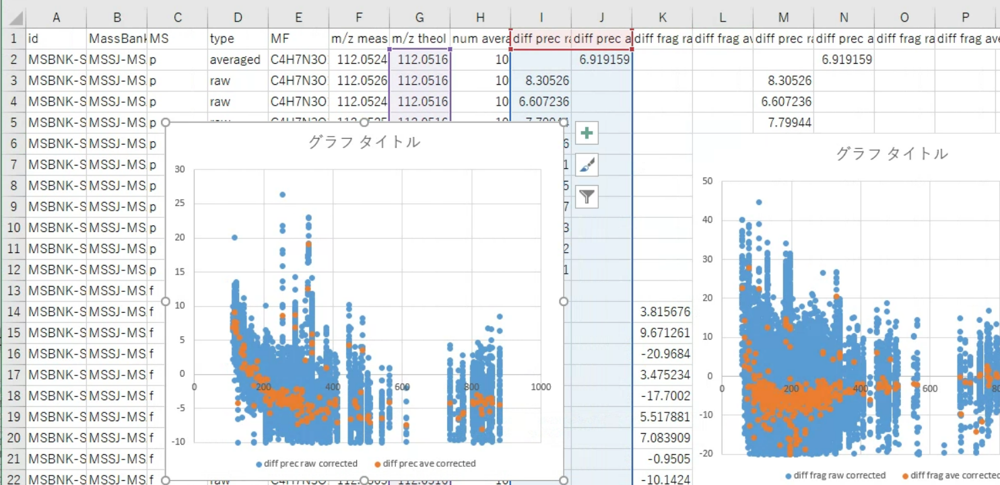
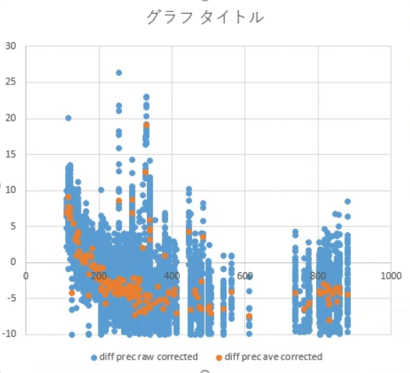
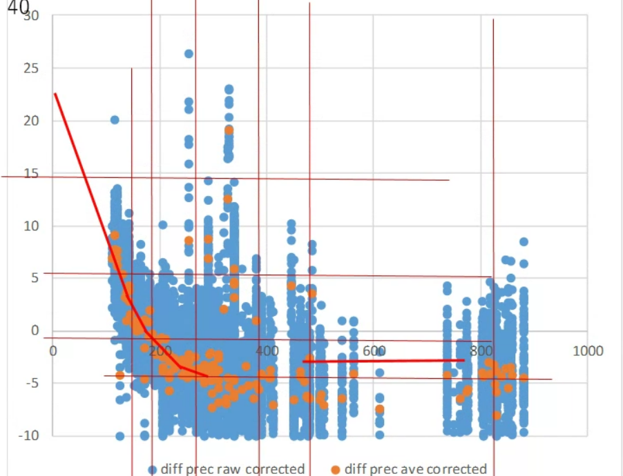
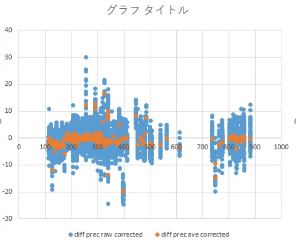

# Shin-MassBank Averaging Pipeline — Manual 2026

> Step-by-step guide for the Shin-MassBank reanalysis pipeline.

This manual is an Step-by-step guide for the Shin-MassBank reanalysis pipeline. Part 1 is for environment setup. Part 2 explains a data processing workflow

---

## Table of Contents

- [Overview](#overview)
- [Part 1 — Environment Setup](#part-1--environment-setup)
  - [1.1 Install Python (Miniconda)](#11-install-python-miniconda)
  - [1.2 Create the ShinMassBank Folder Structure](#12-create-the-shinmassbank-folder-structure)
  - [1.3 Create the Python Virtual Environment](#13-create-the-python-virtual-environment)
  - [1.4 Install the Hive SDK and hivetools](#14-install-the-hive-sdk-and-hivetools)
  - [1.5 Install pySPLASH](#15-install-pysplash)
  - [1.6 Install MetFrag, MS-FINDER and SIRIUS 6](#16-install-metfrag-ms-finder-and-sirius-6)
- [Part 2 — Data Processing Workflow](#part-2--data-processing-workflow)
  - [Step 1. Prepare a dataset and get a dataset ID](#step-1-prepare-a-dataset-and-get-a-dataset-id)
  - [Step 2. Create folders and convert files to Hive format](#step-2-create-folders-and-convert-files-to-hive-format)
  - [Step 3. Create RecordTemplate.txt](#step-3-create-recordtemplatetxt)
  - [Step 4. Averaging](#step-4-averaging)
  - [Step 5. Processing](#step-5-processing)
  - [Step 6. Check calibration (first pass)](#step-6-check-calibration-first-pass)
  - [Step 7. Second averaging and calibration check](#step-7-second-averaging-and-calibration-check)
  - [Step 8. Annotation](#step-8-annotation)
  - [Step 9. Collect annotation results](#step-9-collect-annotation-results)
  - [Step 10. Estimate the FDR](#step-10-estimate-the-fdr)
  - [Step 11. Curate annotation levels](#step-11-curate-annotation-levels)
  - [Step 12. Extract files for MassBank Human](#step-12-extract-files-for-massbank-human)
  - [Step 13. Check processing status](#step-13-check-processing-status)
- [Reference](#reference)
  - [Command-line options](#command-line-options)
  - [Folder layout of a dataset](#folder-layout-of-a-dataset)
  - [RecordTemplate.txt parameters](#recordtemplatetxt-parameters)
  - [Format of annotation output.txt](#format-of-annotation-outputtxt)
- [Notes on Differences from the Original Manual](#notes-on-differences-from-the-original-manual)

---

## Overview

The pipeline converts vendor raw files into Hive format, averages similar MS2 spectra of the same precursor across many files, re-calibrates m/z, annotates the averaged spectra with several tools, estimates the false discovery rate (FDR), and exports curated MassBank records.

All stages are run through one command-line wrapper, `DDApipeline.py`. Each stage is switched on by an option flag.

| Step | Stage | Command (example dataset `HSA001`) | Output |
|:---:|---|---|---|
| 2 | Convert raw files to Hive | `python DDApipeline.py HSA001 -v` | `hmd/` |
| 4 | Averaging | `python DDApipeline.py HSA001 -a` | `step1/`, `log/` |
| 5 | Processing (calibration, formula search) | `python DDApipeline.py HSA001 -p` | `step2/`, `HSA001_mzcomparison.csv` |
| 8 | Annotation | `python DDApipeline.py HSA001 -anno MS-FINDER` | `annotation/` |
| 9 | Retrieve annotation results | `python DDApipeline.py HSA001 -r` | `step3/` |
| 10 | FDR estimation | `python DDApipeline.py HSA001 -f` | `annotation/ZBRA/` |
| 11 | Curation | `python DDApipeline.py HSA001 -c` | `step4/` |
| 12 | Finalize for MassBank Human | `python DDApipeline.py HSA001 -l` | `MassBank Human/HSA001/`, mzTab |
| 13 | Check status | `python Logcheck.py HSA001` | console |

Things worth knowing before you start:

- **Windows only.** The pipeline has been verified only on Windows 11 with Miniconda.
- Run every command from the `script/` folder with the `smb` conda environment active.
- Most stages accept **several dataset IDs** and **several flags** in one call, for example:

  ```
  > python DDApipeline.py HSA001 HSA002 -a -p
  ```

- Paths in this manual assume the pipeline lives in `C:/ShinMassBank/`. Use whichever drive and folder you chose, but keep the same layout.

---

## Part 1 — Environment Setup

You only need to do this once per computer.

### 1.1 Install Python (Miniconda)

Install **Miniconda**, a lightweight Python distribution. Operation has only been verified with Miniconda on Windows 11.

### 1.2 Create the ShinMassBank Folder Structure

Expand the `ShinMassBank` folder from GitHub directly under a drive root so that it looks like this:

```
C:/ShinMassBank/
├── data/             # datasets being processed
├── script/           # pipeline scripts (run commands from here)
├── software/         # external tools (Hive SDK, MetFrag, MS-FINDER, ...)
├── MassBank Human/   # final records for MassBank Human
└── manual/           # this manual
```

### 1.3 Create the Python Virtual Environment

**1. Create and activate the environment.**

```
> conda create -n smb python=3.12 numpy scipy joblib
> activate smb
```

**2. Install the remaining packages.** Use either conda or pip.

*Using conda:*

```
> conda install conda-forge::numba conda-forge::matplotlib
> conda install anaconda::pandas
> conda install bioconda::pubchempy
> conda install -c conda-forge rdkit
```

If you want to generate your own proseterior distributions of Zipf parameters by DDAZipf.py, please install pymc

*Using conda:*

```
> conda install conda-forge::numba conda-forge::matplotlib conda-forge::pymc conda-forge::gxx
> conda install anaconda::pandas
> conda install bioconda::pubchempy
```

*Using pip:*

```
> pip install torch torchvision --index-url https://download.pytorch.org/whl/cpu
> pip install rdkit pulp statsmodels tensorboard tqdm pyyaml chemprop==1.6.1 numpy==1.26.4 numba pandas pubchempy joblib scipy pymc
```

### 1.4 Install the Hive SDK and hivetools

**Hive** is a data format developed by reifycs. The Hive SDK provides:

1. a converter from every vendor's raw file format to Hive, and
2. a Python library to open Hive files.

**1. Get the SDK.** Go to <https://ja.reifycs.com/products/hive/> and choose **Try beta release**. Place the extracted SDK in `ShinMassBank/software/`.

**2. Install hivetools.** Follow the SDK's own manual to install the Python package (`hive_data_access`) into the `smb` environment.

**3. Set the converter hmdc.exe path in `script/settings.ini`.** The path is relative to the `script/` folder:

```ini
hive = ..\software\HiveSDK_0.19.0_JA\Program\hmdc\hmdc
```

### 1.5 Install pySPLASH

Every MassBank record must carry a SPLASH tag. **pySPLASH** is the Python library that generates it from spectral data.

**1.** Download the source from <https://github.com/berlinguyinca/spectra-hash/tree/master>.

**2.** With the `smb` environment active, move to the `python` folder of the downloaded source and run:

```
> python setup.py install
```

### 1.6 Install MetFrag, MS-FINDER and SIRIUS 6

Each tool needs a path entry in `script/settings.ini`. All relative paths are relative to the `script/` folder.


#### SIRIUS 6

1. Create an account on the SIRIUS website. The login ID is your e-mail address; keep the password.
2. Download `sirius-6.3.0-win64.msi` from <https://github.com/sirius-ms/sirius/releases> and install it with the default options.
3. Set the path in `settings.ini`:

   ```ini
   SIRIUS6 = C:/Program Files/sirius/
   ```

#### MS-FINDER

1. Download **MS-FINDER 3.61** from <https://systemsomicslab.github.io/compms/msfinder/main.html> and extract it into `ShinMassBank/software/MSFINDER/`.
2. Set the path in `settings.ini`:

   ```ini
   execmsfinder = ..\software\MSFINDER\MsfinderConsoleApp.exe
   ```

#### MetFrag

1. Download `MetFragCommandLine-2.6.1.jar` from <https://ipb-halle.github.io/MetFrag/projects/metfragcl/>.
2. Download pubchemlite file `PubChemLite_exposomics_20241227.csv` from <https://zenodo.org/records/14560968/files/PubChemLite_exposomics_20241227.csv?download=1>.
3. Place them in `ShinMassBank/software/`.
4. Install a JDK, for example `jdk-23_windows-x64_bin.msi` from <https://www.oracle.com/jp/java/technologies/downloads/#jdk23-windows>.

5. Generate strucuture DB from MsfinderStructureDB-VS15.esd of MS-FINDER. Describe path to "MsfinderStructureDB-VS15.esd" in '/MSFINDER/Resources/' of your environment. 

```
> cd C:\ShinMassBank\script
> python DDAtools.py -d ../software/MSFINDER/Resources/MsfinderStructureDB-VS15.esd
```

MsfinderStructureDB-VS15_forMetFrag.csv is generated in `ShinMassBank/software/`

6. Set the paths in `settings.ini`:

   ```ini
   java = C:/Program Files/Java/jdk-22/bin/java.exe
   execmetfrag = ../software/MetFragCommandLine-2.6.1.jar
   MetFrag_pubchemlite_db =  ../software/PubChemLite_exposomics_20241227.csv
   MetFrag_msfinder_db =  ../software/MsfinderStructureDB-VS15_forMetFrag.csv
   ```

> **Note:** Make the `java` path match the JDK version you actually installed (the example says `jdk-22`, the installer above is `jdk-23`).

### 1.7 Generate exact mass data

1. Generate Molecular forumula <=> exact mass table. It will be overnight task. Please move to /ShinMassBank/script/ folder.

```
> cd C:\ShinMassBank\script
> python DDAtools.py -e
```


### 1.8 Generate GNPS/MassBank spectral libirary

1. Get "MassBank-data" folder from https://github.com/MassBank/MassBank-data and put it in /script/spectra/. Folder name must be "MassBank-data".
2. Get "ALL_GNPS_NO_PROPOGATED.json" file from https://external.gnps2.org/gnpslibrary and put it in /script/spectra/.
3. Generate spectral libraries using DDAtools.py
```
> cd C:\ShinMassBank\script
> python DDAtools.py -spec
```
4. Following folders are generated in /script/spectra/.
- MassBankpositive
- MassBanknegative
- GNPSpositive
- GNPSnegative

---

## Part 2 — Data Processing Workflow

The steps below are run in order for each dataset. The first pass (Steps 4–6) is used to measure mass accuracy; the second pass (Step 7) applies the measured corrections.


### Step 1. Prepare a dataset and get a dataset ID

Collect the raw data files that make up one **dataset** (the group of files that will be averaged together). The files must meet all of these conditions:

- [x] Acquired in **DDA** mode
- [x] Acquired in a **single polarity** (no positive/negative switching)
- [x] Acquired with a **single method** (retention time is also used for averaging)
- [x] Acquired from **similar samples**
- [x] Acquired within **one calibration**
- [x] **10 or more files**

Then obtain a **dataset ID** with the format `[A-Z]{3}[0-9]{3}` (for example `HSA001`).

> The Shin-MassBank project manages IDs itself. If you plan to publish re-analyzed data in the future, contact the Shin-MassBank project so the ID namespace stays consistent.

### Step 2. Create folders and convert files to Hive format

**2-1. Create the dataset folder** (example: `HSA001`).

Under `data/`, create the folder `HSA001`. Put `RecordTemplate.txt` in it (copy one from another dataset), and create a sub-folder named `rawdata` holding the raw files.
Please download positive ion mode data files "_posi" from https://repository.massbank.jp/entry/MPST000004
```
data/
└── HSA001/
    ├── RecordTemplate.txt
    └── rawdata/
        ├── 1_posi.xxx
        ├── 2_posi.xxx
        └── ...
```

**2-2. Convert to Hive (`.hmd`) format.**

```
> cd C:\ShinMassBank\script
> python DDApipeline.py HSA001 -v
```

The `HSA001/hmd/` folder is created automatically. The conversion succeeded if it contains an `.hmd` file for every raw file.

```
data/
└── HSA001/
    ├── RecordTemplate.txt
    ├── rawdata/   1_posi.xxx, 2_posi.xxx, ...
    └── hmd/       1_posi.hmd, 2_posi.hmd, ...
```

### Step 3. Create RecordTemplate.txt

`RecordTemplate.txt` holds two kinds of information:

1. the **thresholds and settings** used for averaging, and
2. the **content written to every generated MassBank record**.

It is a tab-separated text file. A complete example for `HSA001`:

```text
PARAMETER:	ms1_mz_raw_thres	10
PARAMETER:	ms2_mz_raw_thres	20
PARAMETER:	ms1_mz_averaged_thres	10
PARAMETER:	ms2_mz_averaged_thres	20
PARAMETER:	retentiontime_thres	1.5
PARAMETER:	dotproduct_thres	0.9
PARAMETER:	ms1_mz_correction	[]
PARAMETER:	ms2_mz_correction	[]
PARAMETER:	size_minimum	10
PARAMETER:	accession_stem	MSBNK-SMB_Measured-HSA001
PARAMETER:	mode	unitmass
PARAMETER:	unitmass_start	70
PARAMETER:	unitmass_end	1200
RECORD_TITLE:	*	Averaged data
AUTHORS:	*	Shin-MassBank project
LICENSE:	*	CC BY-NC-SA
PUBLICATION:	*	Shin-MassBank project in preparation
COMMENT:	*	This is an averaged mass spectra data created by averaging product ion scan data obtained from the following DDA dataset.
COMMENT:	REPOSITORY	MB-POST
COMMENT:	DATASET_ID	MPST000004
COMMENT:	DATASET_TITLE	Annotation of various metabolites in SRM 1950 human serum
COMMENT:	DATASET_AUTHORS	Masatomo Takahashi, Yoshihiro Izumi, The Universitu of Osaka
COMMENT:	DATASET_PUBLICATION	N/A
COMMENT:	DATASET_PUBLICATION_PMID	N/A
CH$NAME:	*	Uncharacterized
CH$COMPOUND_CLASS:	*	Uncharacterized
CH$FORMULA:	*	C39H42O2
CH$EXACT_MASS:	*	542.31848
CH$SMILES:	*	CCCC#Cc1cc(C#CCCC)cc(C#Cc2cc(C#CC(C)(C)C)c(cc2C#CC(C)(C)C)C2OCCO2)c1
CH$IUPAC:	*	InChI=1S/C39H42O2/c1-9-11-13-15-30-25-31(16-14-12-10-2)27-32(26-30)17-18-33-28-35(20-22-39(6,7)8)36(37-40-23-24-41-37)29-34(33)19-21-38(3,4)5/h25-29,37H,9-12,23-24H2,1-8H3
CH$LINK:	PUBCHEM	CID:11353257
SP$SCIENTIFIC_NAME:	*	Homo sapiens
SP$LINK:	*	NCBI-TAXONOMY 9606
SP$SAMPLE:	*	Plasma
AC$INSTRUMENT:	*	Nexera X2 UHPLC system, Shimadzu - Q Exactive Orbitrap, Thermo Scientific
AC$INSTRUMENT_TYPE:	*	LC-ESI-QFT
AC$MASS_SPECTROMETRY:	MS_TYPE	MS2
AC$MASS_SPECTROMETRY:	ION_MODE	POSITIVE
AC$MASS_SPECTROMETRY:	COLLISION_ENERGY	20 V
AC$MASS_SPECTROMETRY:	COLLISION_GAS	N2
AC$MASS_SPECTROMETRY:	FRAGMENTATION_MODE	CID
AC$MASS_SPECTROMETRY:	ION_SPRAY_VOLTAGE	4.0 kV
AC$MASS_SPECTROMETRY:	IONIZATION	ESI
AC$CHROMATOGRAPHY:	COLUMN_NAME	GL-HilicAex 2.1 x 150 mm, 5 mm (Resonac)
AC$CHROMATOGRAPHY:	FLOW_GRADIENT	B conc(%). 0 min: 95, 0.5 min: 95, 15.5 min: 40, 16.5 min: 0, 26.5 min: 0, 27.5 min: 95, 35 min: 95.
AC$CHROMATOGRAPHY:	FLOW_RATE	0.4 mL/min
AC$CHROMATOGRAPHY:	SOLVENT	A 40 mM ammonium bicarbonate in H2O (pH 9.8)
AC$CHROMATOGRAPHY:	SOLVENT	B Acetonitrile
```

The file has two parts, described below.

#### 3-1. `PARAMETER:` lines — thresholds for averaging

| Parameter | Meaning | Guidance |
|---|---|---|
| `ms1_mz_raw_thres`<br>`ms2_mz_raw_thres` | m/z tolerance (**ppm**) used when averaging raw spectra, for MS1 and MS2. It corresponds to roughly **4σ** of the m/z scatter. To decide whether two signals from two spectra match, **twice** this value is used (strictly √2 times would be correct, but a larger value is used deliberately). | First pass: Q-TOF **20 / 40**, Orbitrap **10 / 20**. Refine in Step 6. |
| `ms1_mz_averaged_thres`<br>`ms2_mz_averaged_thres` | m/z tolerance (**ppm**) used to analyze the *averaged* data (MS1, MS2), also about 4σ. Twice this value is used to decide whether two signals match. For molecular-formula calculation it is used **as is**. | First pass: same as the raw thresholds. After refinement it is typically **1/2 to 1/3** of `ms1_mz_raw_thres`. |
| `retentiontime_thres` | Retention-time window (**minutes**). Two spectra whose elution times differ by less than this are treated as matching. | `1.5` — do not change. |
| `dotproduct_thres` | Dot-product score (unitless). Two spectra scoring above this value are treated as matching. | `0.9` — do not change. |
| `ms1_mz_correction`<br>`ms2_mz_correction` | Software m/z calibration as a list of `(m/z, ppm shift)` points. | Leave as `[]` in the first pass; fill in from Step 6. |
| `size_minimum` | Minimum number of raw spectra that must be combined into one averaged spectrum. | `10` — do not change. |
| `accession_stem` | Stem of the MassBank accession of the averaged spectra. | `MSBNK-SMB_Measured-<datasetID>` |
| `mode`<br>`unitmass_start`<br>`unitmass_end` | With `mode unitmass`, precursors with m/z between `unitmass_start` and `unitmass_end` are averaged. Internally the run proceeds step by step through unit-mass windows (m/z ≈ 70, 71, …). | Set the range to match your data. |

**First-pass starting values** (added 2025.09.01):

| Instrument | `ms1_mz_raw_thres` | `ms2_mz_raw_thres` | `ms1_mz_averaged_thres` | `ms2_mz_averaged_thres` |
|---|:---:|:---:|:---:|:---:|
| Q-TOF | 20 | 40 | 20 | 40 |
| Orbitrap | 10 | 20 | 10 | 20 |

**Typical values after the second pass** (MS1 / MS2 raw thresholds):

| Instrument | MS1 raw | MS2 raw |
|---|:---:|:---:|
| TripleTOF | 10 | 20 |
| Shimadzu LCMS-9030 | 5 | 10 |
| Orbitrap | 1.5 | 10 |

> **Note:** The example above uses `unitmass_end 1200`, while the original explanation text mentions `1000`. Set the upper limit to suit your instrument's scan range.

#### 3-2. Record fields — content written to every MassBank record

| Field | What to write | Change per dataset? |
|---|---|:---:|
| `RECORD_TITLE`, `AUTHORS`, `LICENSE` | `Averaged data`, `Shin-MassBank project`, `CC BY-NC-SA` | No |
| `PUBLICATION` | The dataset's paper. Omit if there is none. | Yes |
| `COMMENT: *` | The standard sentence on averaged spectra. | No |
| `COMMENT: REPOSITORY / DATASET_ID / DATASET_TITLE / DATASET_AUTHORS / DATASET_PUBLICATION / DATASET_PUBLICATION_PMID` | Repository name, dataset ID, title, authors, and publication of the source dataset. | Yes |
| `CH$NAME` … `CH$LINK` | An "uncharacterized" placeholder compound (`nanokid`) for spectra without an identified compound. | No |
| `SP$SCIENTIFIC_NAME` | Species name of the sample, e.g. `Homo sapiens`. | Yes |
| `SP$LINK` | NCBI Taxonomy ID of that species, e.g. `NCBI-TAXONOMY 9606`. Look it up at <https://www.ncbi.nlm.nih.gov/taxonomy>. | Yes |
| `SP$SAMPLE` | Sample part or type, e.g. `Serum`. Free text at present. | Yes |
| `AC$INSTRUMENT` | Instrument names (LC and MS). | Yes |
| `AC$INSTRUMENT_TYPE` | Must be `LC-ESI-QTOF` or `LC-ESI-QFT` (Orbitrap is "FT"). | Yes |
| `AC$MASS_SPECTROMETRY` | MS type, ion mode, collision energy, gas, fragmentation mode, ionization settings. | Yes |
| `AC$CHROMATOGRAPHY` | LC conditions: column, gradient, flow rate, solvents. | Yes |

> **Note:** Editing `RecordTemplate.txt` later does not require re-running the whole pipeline. The record fields are applied in [Step 12](#step-12-extract-files-for-massbank-human), so only that step needs to be repeated.

### Step 4. Averaging

Averaging combines the MS2 spectra of each precursor into an averaged MS2 spectrum, and also averages the MS1 spectra in which that precursor was detected. The averaged MS1 is later used to identify in-source fragments and isotope signals.

**4-1. Run averaging.**

```
> cd C:\ShinMassBank\script
> python DDApipeline.py HSA001 -a
```

The `-a` option selects averaging. Several datasets can be processed one after another:

```
> python DDApipeline.py HSA001 HSA002 -a
```

**4-2. Tune memory use (batch size and threads).**

Averaging reads the data one integer mass at a time (70, 71, 72, …) and averages them in parallel.

| Setting | Option | Meaning | Default |
|---|:---:|---|:---:|
| Batch size | `-b` | Number of integer masses loaded at once. Larger values use more memory. | 5 |
| Threads | `-t` | Number of parallel workers. Larger values use more memory. | 1 |

Start with the defaults and increase them if you have spare memory:

```
> python DDApipeline.py HSA001 -a -b 20 -t 5
```

**4-3. Check progress and completion.**

Once the run starts, these folders are created inside `HSA001/`:

```
log/  step1/  step2/  step3/  step4/  annotation/
```

If they already exist, the contents of `step1`, `step2` and `annotation` are emptied first.

**Result files** are written to `step1/`, named like this:

```
MSBNK-SMB_Measured-HSA001P0112000.txt
MSBNK-SMB_Measured-HSA001P0112001.txt
MSBNK-SMB_Measured-HSA001S0112000.txt
MSBNK-SMB_Measured-HSA001S0112001.txt
```

| Part of the name | Meaning |
|---|---|
| `MSBNK-SMB_Measured-HSA001` | The `accession_stem` from `RecordTemplate.txt` |
| `P` or `S` | `P` = averaged **MS2** spectrum, `S` = averaged **MS1** spectrum |
| `0112` | Generated from the precursor at m/z ≈ 112 |
| `000`, `001`, … | First, second, … averaged spectrum for that precursor, ordered by the number of raw spectra used (most first) |

**Log file.** A log is written to `log/`, for example `MSBNK-SMB_Measured-HSA008_averaging_2023.07.11.txt` (the last part is the run date). Averaging finished successfully if the end of the file looks like this:

```text
2023.07.12	Finished	3270	20416	507878	512375	100825	1530370	546934	273437240	11428134
2023.07.12	Finished	Averaged spectra	3270
2023.07.12	Finished	Peaks in averaged MS2 spectra	20416
2023.07.12	Finished	Peaks in averaged MS1 spectra	507878
2023.07.12	Finished	Total raw spectra	512375
2023.07.12	Finished	Used raw spectra	100825
2023.07.12	Finished	Total peaks in averaged MS2 spectra	1530370
2023.07.12	Finished	Used peaks in averaged MS2 spectra	546934
2023.07.12	Finished	Total peaks in averaged MS1 spectra	273437240
2023.07.12	Finished	Used peaks in averaged MS1 spectra	11428134
```

| Log line | Meaning |
|---|---|
| Averaged spectra | Number of averaged MS2 spectra generated |
| Peaks in averaged MS2 spectra | Total number of ions in the averaged MS2 spectra |
| Peaks in averaged MS1 spectra | Total number of ions in the averaged MS1 spectra |
| Total raw spectra | Number of raw MS2 spectra in the data files |
| Used raw spectra | Number of those raw MS2 spectra used for averaging (call it *X*) |
| Total peaks in averaged MS2 spectra | Number of ions in *X* |
| Used peaks in averaged MS2 spectra | Number of those ions actually used for averaging |
| Total peaks in averaged MS1 spectra | Number of ions in the MS1 spectra corresponding to *X* |
| Used peaks in averaged MS1 spectra | Number of those ions actually used for averaging |

### Step 5. Processing

Processing works on the MassBank record files in `step1/` and performs the following:

1. **m/z correction** of MS1 and MS2, followed by **SPLASH** generation from the corrected spectrum.
2. **MS1 analysis**, which determines:
   - the precursor's charge state,
   - whether the precursor may be a stable-isotope-labeled compound,
   - the presence of sulfur (existence and intensity of the +2 isotope),
   - the ion form (`[M+H]+`, `[M+Na]+`, …).
3. **Provisional annotation**:
   - estimation of the precursor's molecular formula,
   - similar-spectrum search.
4. **Annotation check**: when a similar spectrum is found with similarity **S > 0.7** *and* its formula agrees with the estimated formula, that formula is treated as pseudo ground truth. The fragment-ion formulas are then estimated, and the difference between theoretical and measured m/z is reported for both the averaged and the raw spectra.

**5-1. Run processing.**

```
> python DDApipeline.py HSA001 -p
```

The `-p` option selects processing. Multiple datasets and combined steps are allowed:

```
> python DDApipeline.py HSA001 HSA002 -p
> python DDApipeline.py HSA001 HSA002 -a -p
```

**5-2. Check the results.**

- Records with the added annotation information are written to `step2/`. The IDs are unchanged. Only **MS2** records are generated (no MS1 records).
- The annotation-check results are written to `HSA001_mzcomparison.csv`.

### Step 6. Check calibration (first pass)

The first averaging pass applies no m/z correction, so this step measures how far the data are from theoretical values and reads off the thresholds and correction curve to use in the second pass.

**6-1. Open `HSA001_mzcomparison.csv` in Excel.**

The file is in the dataset folder. Select **column G** and **columns I and J**, then insert a scatter plot.



*Figure 1. `HSA001_mzcomparison.csv` with a scatter plot of column G (theoretical m/z) against columns I and J (error).*

Column meaning:

| Column | Content |
|:---:|---|
| A–E | ID, MassBank hit, MS level, spectrum type (`averaged` / `raw`), molecular formula |
| F | m/z measured |
| G | m/z theoretical |
| H | Number of spectra averaged |
| **I** | Precursor MS1 — raw data — deviation from theoretical m/z, **after** correction |
| **J** | Precursor MS1 — averaged data — deviation, **after** correction |
| **K** | MS2 — raw data — deviation, **after** correction |
| **L** | MS2 — averaged data — deviation, **after** correction |
| M | Precursor MS1 — raw data — deviation, **before** correction |
| N | Precursor MS1 — averaged data — deviation, **before** correction |
| O | MS2 — raw data — deviation, **before** correction |
| P | MS2 — averaged data — deviation, **before** correction |

> In the first pass no correction has been applied, so the "before" and "after" columns are identical.

**6-2. Read the thresholds and the correction.**

The plot below shows MS1 data. The horizontal axis is the signal m/z; the vertical axis is the deviation from the theoretical value (ppm).



*Figure 2. MS1 deviation from theoretical m/z before correction. Orange = averaged spectra, blue = raw spectra used for averaging.*

- **Orange** points are averaged spectra; **blue** points are the raw spectra used for averaging.
- Blue points spread above and below each orange point, showing that averaging reduces the scatter.

**Reading `ms1_mz_raw_thres`.** The blue scatter falls almost entirely within ±10 ppm of the orange points, so set `ms1_mz_raw_thres` to **10**.

**Reading `ms1_mz_correction`.** If calibration were good, the orange points would lie flat on 0 with even scatter above and below. Here they are offset from zero and curved, so the calibration is off. Trace a piecewise-linear curve through the orange points:



*Figure 3. A piecewise-linear line (red) traced along the orange averaged points. The correction list is this line with the sign inverted.*

Write the correction as a list of `(m/z, ppm shift)` points, for example:

```
[(0,-25),(160,-3),(190,1.0),(220,3),(280,4),(2000,4)]
```

This means: data at m/z 160 are shifted by −3.0 ppm, data at m/z 190 by +1.0 ppm, and data in between are shifted by **linear interpolation**. Set the last point (here `(2000,4)`) so the shift stays constant above your highest m/z.

**Reading `ms1_mz_averaged_thres`.** The averaged data also scatter, and they stay within about ±3 ppm of the imaginary centre line, so set `ms1_mz_averaged_thres` to **3**.

The MS1 result of this example therefore is:

```text
PARAMETER:	ms1_mz_raw_thres	10
PARAMETER:	ms1_mz_averaged_thres	3
PARAMETER:	ms1_mz_correction	[(0,-25),(160,-3),(190,1.0),(220,3),(280,4),(2000,4)]
```

**Repeat the same procedure for MS2** (columns K, L, O, P) to get `ms2_mz_raw_thres`, `ms2_mz_averaged_thres` and `ms2_mz_correction`.

### Step 7. Second averaging and calibration check

**7-1. Edit `RecordTemplate.txt`.** Replace these values with the ones measured in Step 6:

```text
PARAMETER:	ms1_mz_raw_thres	XX
PARAMETER:	ms2_mz_raw_thres	XX
PARAMETER:	ms1_mz_averaged_thres	XX
PARAMETER:	ms2_mz_averaged_thres	XX
PARAMETER:	ms1_mz_correction	XX
PARAMETER:	ms2_mz_correction	XX
```

The values finally used for `HSA001`:

```text
PARAMETER:	ms1_mz_raw_thres	1.5
PARAMETER:	ms2_mz_raw_thres	8
PARAMETER:	ms1_mz_averaged_thres	0.75
PARAMETER:	ms2_mz_averaged_thres	4
PARAMETER:	ms1_mz_correction	[(0, -20), (65.34666716191401, -7.798223487441572), (95.7115866297117, -2.2164256838345873), (137.85048230506223, 2.482757781179227), (190.64643434170497, 1.5805521085631864), (256.97026492238103, 2.0434311917110035), (900, 1.8406599289898224)]
PARAMETER:	ms2_mz_correction	[(0, -20), (65.85163969071122, -9.742892273871496), (92.15268734059067, -4.120457736723138), (133.89736293588, 0.6849169851694156), (900, 0.5057764676935759)]
PARAMETER:	size_minimum	10
```

**7-2. Run averaging and processing again.**

```
> python DDApipeline.py HSA001 -a -p
```

**7-3. Check the calibration.** Open the new `HSA001_mzcomparison.csv` and confirm the calibration worked. The corrected orange points should now sit flat around 0.



*Figure 4. MS1 deviation after correction: the averaged (orange) points are centred on 0 ppm.*

If they do not, repeat Steps 6–7.

### Step 8. Annotation

Annotation reads the files generated in `step2/`, adds annotations with each software tool, and writes results to `data/HSA001/annotation/`.

> Annotation is expected to be **re-run periodically** as the software is updated.

**8-1. Choose the annotation tool(s).**

| Tool | Command | Description |
|---|---|---|
| MS-FINDER | `python DDApipeline.py HSA001 -anno MS-FINDER` | Structure/formula annotation with MS-FINDER |
| MetFrag (MS-FINDER DB) | `python DDApipeline.py HSA001 -anno MetFragMSFINDER` | MetFrag using the MS-FINDER compound database |
| MetFrag (PubChemLite) | `python DDApipeline.py HSA001 -anno MetFragPubChemLite` | MetFrag using the PubChemLite compound database |
| SIRIUS 6 | `python DDApipeline.py HSA001 -anno SIRIUS6 -sirius <email>` | SIRIUS 6 (needs a SIRIUS account) |
| Spectral similarity | `python DDApipeline.py HSA001 -anno SimilarityGNPS` | Spectral similarity: cosine (dot-product) score plus spectral entropy |

**SIRIUS 6 login.** The `-sirius` option takes the e-mail address of your SIRIUS account. On its own, the password is requested on standard input at login. To automate it, create a text file containing **only your SIRIUS password on one line**, save it as `script/pw.txt`, and redirect it into the command:

```
> python DDApipeline.py HSA001 -anno SIRIUS6 -sirius your.name@example.com < pw.txt
```

> **Security:** `pw.txt` holds a plain-text password. Do not commit it to Git or share it.

**8-2. Batch processing tips.**

*Tip 1 — several datasets at once:*

```
> python DDApipeline.py HSA001 HSA002 HSA003 -anno MS-FINDER
```

*Tip 2 — several annotation methods at once:*

```
> python DDApipeline.py HSA001 HSA002 HSA003 -anno MS-FINDER SIRIUS6 MetFragMSFINDER MetFragPubChemLite -sirius your.name@example.com < pw.txt
```

*Tip 3 — parallelism:*

- `MS-FINDER`, `MetFragMSFINDER` and `MetFragPubChemLite` can be run in **multiple processes in parallel**.
- `SIRIUS6` can run in **one process only**, because of the account restriction.

**8-3. Check the results.**

Inputs and results are saved under `data/HSA001/annotation/`, one folder per tool. The run finished successfully when `output.txt` exists in the tool's folder.

```
data/HSA001/annotation/
├── SIRIUS6/
│   ├── output.txt            <- fixed name
│   └── (other files/folders: free to use)
├── MS-FINDER/
│   ├── output.txt            <- fixed name
│   └── ...
├── MetFragMSFINDER/
│   ├── output.txt            <- fixed name
│   └── ...
└── MetFragPubChemLite/
    ├── output.txt            <- fixed name
    └── ...
```

`output.txt` is always present with that exact name; the other files and folders are free for each tool's own use. The file format is described in [Format of annotation output.txt](#format-of-annotation-outputtxt).

### Step 9. Retrieve annotation results

This step merges each tool's results into the MassBank record files and writes them to `step3/`.

```
> python DDApipeline.py HSA001 -r
> python DDApipeline.py HSA001 HSA002 -r
```

The `-r` option selects *retrieve*. Operations performed:

1. Read the results in each tool's `output.txt`.
2. Read each MassBank record in `step2/` and add the annotation results.
3. Save the MassBank records to `step3/`.

### Step 10. Estimate the FDR

This step integrates the results of the different tools into a single ranking and estimates the false discovery rate.

```
> python DDApipeline.py HSA001 -f
> python DDApipeline.py HSA001 HSA002 -f
```

The `-f` option selects FDR estimation. Operations performed:

1. Calculate the **aggregated rank** and **p-value** (q-value / FalseProb) from the annotation results of each tool.
2. Write the results to `HSA001/annotation/ZBRA/`.
3. The parameters required for the FDR estimation are stored in `script/res/zipf/`.

> **Note:** The original manual names the output folder `annotation/Baysian/`. The current code writes to `annotation/<zbramethod>/`, where `zbramethod = ZBRA` in `settings.ini`.

### Step 11. Curate annotation levels

Curation assigns an **annotation level** to each record based on its annotation results. For Level 2 and 3 annotations, compound data are added and the `CH` fields of the record are rewritten.

> This stage is under development and must be **re-run after every code change**.

```
> python DDApipeline.py HSA001 -c
> python DDApipeline.py HSA001 HSA002 -c
```

The `-c` option selects curation. Operations performed:

1. Read each MassBank record from `step3/`.
2. Decide the annotation level. For Levels 2 and 3, compound data are fetched from PubChem through its API.
3. Write the files to `step4/`.

**PubChem cache.** Every compound looked up through the PubChem API is cached in `script/pubchem_checked.pkl`, so a compound already fetched is not requested again.

### Step 12. Extract files for MassBank Human

This step collects the files created so far, tidies their content, and copies them per dataset to:

```
ShinMassBank/MassBank Human/HSAXXX/
```

While doing so it **overwrites each field with the information in `RecordTemplate.txt`**. If you rewrite `RecordTemplate.txt`, you only need to repeat this step.

It also generates a file in **mzTab** format (experimental):

```
ShinMassBank/data/HSA001/ShinMassBank_HSA001.mztab
```

```
> python DDApipeline.py HSA001 -l
> python DDApipeline.py HSA001 HSA002 -l
```

The `-l` option selects *finalize*.

> **Note:** The original manual uses `-f` for this step, but `-f` is FDR estimation (Step 10). In the current `DDApipeline.py` finalize is **`-l`** (`--finalize`).

### Step 13. Check processing status

`Logcheck.py` reports how far each dataset has progressed, with start and end times.

```
> python Logcheck.py HSA005
```

Example output:

```text
hsa005 **********************
hsa005 averaging Finished ['2025.01.29.11.46.38', '763']
hsa005 processing Started ['2025.01.29.11.46.38']
hsa005 processing Finished ['2025.01.29.11.49.32']
hsa005 processing Calibration Started ['2025.01.29.11.49.32']
hsa005 annotation Started ['2025.01.29.11.49.58', 'MS-FINDER']
hsa005 processing Calibration Finished ['2025.01.29.11.49.58', '102', '103']
hsa005 annotation Finished ['2025.01.29.12.14.15', 'MS-FINDER']
hsa005 annotation Started ['2025.01.29.12.14.15', 'MetFrag']
hsa005 annotation Finished ['2025.01.29.12.21.30', 'MetFrag']
hsa005 annotation Started ['2025.01.29.12.21.30', 'MetFrag']
hsa005 annotation Finished ['2025.01.29.12.30.40', 'MetFrag']
hsa005 annotation Started ['2025.01.29.12.30.49', 'SIRIUS5']
hsa005 annotation Finished ['2025.01.29.12.35.14', 'SIRIUS5']
hsa005 annotation Started ['2025.01.29.12.35.20', 'SIRIUS6']
hsa005 annotation Finished ['2025.01.29.12.42.01', 'SIRIUS6']
hsa005 curation Started ['2025.01.29.12.42.10']
hsa005 curation Finished ['2025.01.29.12.42.47']
```

| Usage | Command |
|---|---|
| Several datasets | `python Logcheck.py HSA001 HSA002` |
| All datasets in the `data` folder | `python Logcheck.py` |
| Delete all past logs of a dataset | `python Logcheck.py HSA001 -r` |

> **Note:** The script file is named `Logcheck.py` (lowercase "c") in the repository.

---

## Reference

### Command-line options

All options belong to `python DDApipeline.py <dataset ID> [<dataset ID> ...] [options]`.

| Option | Long form | Stage | Notes |
|:---:|---|---|---|
| `-v` | `--hiveconvert` | Convert raw files to Hive | Step 2 |
| `-a` | `--averaging` | Averaging | Step 4 |
| `-b` | `--batchsize` | Batch size of unit masses | Default 5 |
| `-t`, `-n` | `--thread` | Number of CPU threads | Default 1 |
| `-p` | `--processing` | Processing / re-calibration | Step 5 |
| `-anno` | `--annotation` | Annotation | Names: `MS-FINDER`, `MetFragMSFINDER`, `MetFragPubChemLite`, `SIRIUS6`, `SimilarityGNPS`, `SimilarityMassBank`; several may be given |
| `-sirius` | `--siriusid` | SIRIUS account e-mail | Used with `-anno SIRIUS6` |
| `-s` | `--reset` | Reset annotation results | |
| `-r` | `--retrieve` | Retrieve annotation results | Step 9 |
| `-f` | `--fdr` | FDR estimation | Step 10 |
| `-c` | `--curation` | Curation | Step 11 |
| `-l` | `--finalize` | Final records and mzTab | Step 12 |

Flags can be combined; for example `python DDApipeline.py HSA001 HSA002 -a -p` runs averaging then processing for both datasets.

### Folder layout of a dataset

```
data/HSA001/
├── RecordTemplate.txt        # settings and record content (edit this)
├── HSA001_mzcomparison.csv   # calibration check (Step 5)
├── ShinMassBank_HSA001.mztab # experimental mzTab export (Step 12)
├── rawdata/                  # vendor raw files (input)
├── hmd/                      # Hive-format files (Step 2)
├── log/                      # logs (Step 4 onward)
├── step1/                    # averaged MS1 (S) and MS2 (P) records (Step 4)
├── step2/                    # processed MS2 records (Step 5)
├── step3/                    # records with annotation results (Step 9)
├── step4/                    # curated records (Step 11)
└── annotation/               # per-tool inputs and results (Step 8, 10)
    ├── SIRIUS6/output.txt
    ├── MS-FINDER/output.txt
    ├── MetFragMSFINDER/output.txt
    ├── MetFragPubChemLite/output.txt
    └── ZBRA/                 # FDR result (Step 10)
```

### RecordTemplate.txt parameters

See the table in [Step 3-1](#3-1-parameter-lines--thresholds-for-averaging) for details of each `PARAMETER:` line and [Step 3-2](#3-2-record-fields--content-written-to-every-massbank-record) for the record fields.

### Format of annotation output.txt

`output.txt` is a **tab-separated** text file. Each line has these columns:

| # | Column | Content |
|:---:|---|---|
| 1 | MassBank ID | e.g. `MSBNK-SMB_Measured-HSA001P0071005` |
| 2 | Target | `compound`, `mf` (molecular formula) or `class` |
| 3 | Software + scoring method | One of: `SevenGoldenRules`, `SIRIUS6_Confidence`, `SIRIUS6_CSI`, `SIRIUS6_Zodiac`, `SIRIUS6_Sirius`, `MS-FINDER`, `MetFrag`, `Entropy`, `SIMILARITY`, `Aggregated_ranking`, `Aggregated_ranking_2`, `q-value`, `FalseProb`, `q-value_2`, `FalseProb_2` |
| 4 | Database name | `MS-FINDER_DB`, `GNPS`, `PubChemLite`, `biodatabase`, `ZBRA`, `MassBank` |
| 5 | Score | The score output by each software |
| 6 | Result | For `compound`: InChIKey or the InChIKey first block. For `mf`: the molecular formula before adding the ion form |
| 7 | Ion form | *Optional.* e.g. `[M+H]+` |
| 8 | Name | *Optional.* Compound name, for `compound` results |

